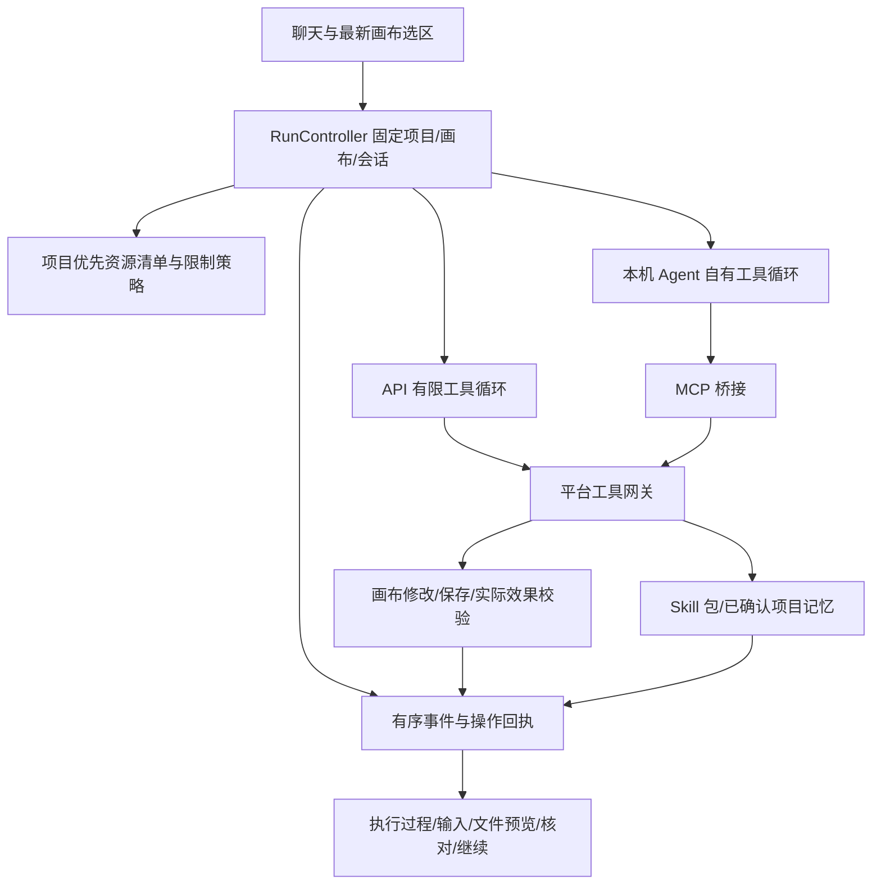

# Agent 架构与运行契约（0.5.0）

对话、画布和项目文件共用一个有边界、可恢复的任务运行。简单绘图和明确的选区修改直接处理；复杂任务才需要计划和必要的人工反馈。

## 运行模型

`src/lib/agent/controller.ts` 串行保存事件和操作回执，合并密集的文本增量，并绑定取消信号。创建时固定 conversation、backend、project、canvas 和选区摘要；准备阶段补充资源来源及实际能力，执行后不重新绑定目标。画布任务互斥。

生命周期为 created → preparing → running → validating → succeeded，支持 waiting_input、repairing、取消、失败、中断和 needs_reconciliation。成功必须没有未核对的操作。原任务结束或中断后，继续任务创建关联的新 run；事件回放没有执行副作用。

桌面日志位于项目 `.ai-excalidraw/runs/<runId>.json`，没有项目时放在应用数据目录。原子替换、跨进程锁、私有文件权限、大小限制和凭据字段脱敏保护日志。启动或界面恢复将未完成的准备操作标为 unknown，并记录中断，不自动重试写入。网页采用同一事件协议的本地存储；实际文件核对仅由桌面原生服务完成。

## 两类循环

API 适配器解析有界 UTF-8 SSE，分别处理正文、公开摘要、工具调用和已报告用量，等待异步工具结果后才发起下一次模型请求。默认上限 8 次模型调用、2 次工具修复；相同无进展修改停止。流截断、空回答、HTTP 错误和预算耗尽是失败，不切换提供方。项目策略可以进一步收紧预算。

Codex 优先使用经过只读能力检测的 app-server，关联原生 thread 和平台会话，下一轮恢复同一个项目/画布/会话。只有在执行前确认无 app-server 能力时使用 exec 兼容路径，并明确说明未恢复原生会话；原生执行开始后的失败不会再执行一遍。Claude、Pi、Cursor 保留各自原生循环及已有事件解析。平台不在原生循环外套第二个工具推理循环。

原生会话有初始化、空闲、工具和总时长限制，取消会发送 interrupt 并回收进程。真实人工输入可暂停普通空闲等待，但不能延长总时限。仅展示提供方公开摘要，忽略原始隐藏推理；缺失 usage 保持未知。原生累计 usage 展示最后快照，API 展示本轮已报告总量。当前未宣称支持运行中 steer 或原生审批；需要补充时停止后继续新一轮。原生内部模型调用次数由对应工具管理，API 的 maxTurns 不冒充原生内部步数控制。

## 画布和文件

CanvasGateway 在副作用前保存稳定 operationId、指纹、目标和前态，执行前检查当前版本及场景，执行后核验请求字段并等待实际保存。相同已应用编号返回原回执；不同参数复用编号、未知操作以及保存失败后的盲目重试均被拒绝。流式元素也经过同一网关，保留已有 ID；Markdown 示例、工具结果和思考摘要不作为画布命令。显式 canvas 输出不完整时不能完成。

结果未知的画布操作按磁盘投影核对，文件操作按实际包版本和内容哈希核对。用户提供的 proof 不作为事实。核对只读取业务文件；原运行保留历史失败状态，核对后可继续剩余任务。局部回退按实际操作顺序逆序补偿，拒绝覆盖后续用户编辑；不调用全局撤销，也不宣称回退任意原生 shell 副作用。

项目服务优先读取 `.agents/skills`、`.agents/mcp.json`、`.agents/policy.json` 和 `.agents/memory`。项目同名资源覆盖全局，显式禁用保留；允许列表、禁止列表及预算只能收紧已有能力。全局 Skill 通过清单批准的 `global-skill://` 引用只读访问，不接受任意用户主目录路径。不安全全局条目被隔离并产生警告。

Skill 更新比较包含资源的整包 SHA-256，验证 frontmatter、包名、资源引用和路径，原子发布完整包并保留旧包备份；省略既有资源表示保留。并发版本冲突、路径越界、符号链接和不安全文件类型失败关闭。confirmed memory 仅在用户接受具体内容后保存，明显凭据被拒绝；该检测不承诺穷尽所有秘密。Skill/记忆操作同样在写入前持久化哈希意图，丢失回执可核对而不重放。

原生 CLI 的直接 shell/文件操作仍受该 CLI 自身的沙箱及权限约束，平台网关不是通用进程沙箱。项目策略禁用 MCP 时，应用停止启动不能证明已关闭全部原生 MCP 的本机后端，并明确提示用户可选择 API；不自动切换来源。应用内项目 Skill 保存应通过 write_skill 获取平台可验证的文件凭据；画布图不等于安装成功。

## 交互和验证

同一消息展示执行过程、计划、必要输入、校验、文件凭据与预览，以及中断后的核对/继续入口。画布承载方案与结果，选择和修改作为下一轮反馈；普通形状没有自动批准能力。Skill 的画布流程与实际源文件分别交付。

本机验证证据保存在不随仓库提交的 `.omo/evidence/agent-architecture/`：Rust 原生服务与协议测试、实际 Codex 首轮/恢复 smoke、API 流测试、真实 React/Excalidraw 界面测试。界面文件链路以临时本机 HTTP 桥调用原始 Rust dispatch，原生 Agent 响应脚本化以稳定覆盖成功和回执丢失；实际 Codex 运行另行验证。测试桥与页面在构建前移除，不随应用发布。

可复现的检查命令见 [桌面开发说明](../DESKTOP.md)。项目文件服务的前后端契约可额外运行 `bunx --no-install vitest run --config src-tauri/src/agent_project/vitest.config.ts`。真实用户目录只读检查须显式设置 `AGENT_REAL_MANIFEST_READONLY=1` 和 `AGENT_REAL_MANIFEST_PROJECT` 为自己的项目绝对路径，默认测试不访问该项目。
